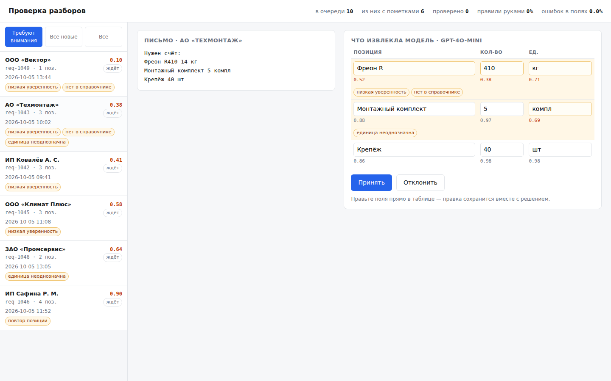

# Рабочее место проверяющего: человек в контуре разбора документов

Интерфейс для случая, когда модель разбирает входящие документы, но решение остаётся за человеком. Оператор видит, что извлекла модель, где она была не уверена, правит поля и отправляет решение. Исправления копятся и выгружаются размеченным набором, на котором дальше меряется качество.



## Зачем

Модель, разбирающая документы, ошибается неравномерно. На типовых письмах она права почти всегда, а на нестандартных ошибается молча — и именно эти случаи дороже всего, если ошибка уходит дальше в счёт или в заказ.

Поэтому задача не в том, чтобы модель была точнее, а в том, чтобы человек тратил внимание только там, где оно нужно. Отсюда три вещи, вокруг которых всё построено:

**Очередь сортируется по уверенности, а не по времени.** Сверху то, где модель слабее всего. Оператор начинает с рискованного, а не с первого попавшегося.

**Неуверенность видна на уровне поля.** Подсвечивается не весь разбор, а конкретная ячейка: тут название обрезано, тут единица допускает два чтения. Глаз идёт сразу в нужное место.

**Правка не затирает ответ модели.** Исходное значение и исправление лежат рядом, поэтому потом можно сказать, где именно модель ошибалась и как часто.

## Как это замыкается

Проверенные разборы отдаются через `/api/dataset` в формате набора: вход — исходное письмо, эталон — то, что подтвердил или исправил человек.

```json
{"id": "req-1043", "input": "Нужен счёт:\nФреон R410 14 кг\n...", "expected": {"items": [{"name": "Фреон R410", "qty": 14, "unit": "кг"}]}, "meta": {"was_corrected": true}}
```

Этот файл кладётся прямо в [llm-eval-harness](https://github.com/Tarcuss0/llm-eval-harness) и становится набором, на котором проверяется следующая версия промпта. Работа оператора перестаёт быть только исправлением текущей заявки и превращается в разметку, на которой видно, стало ли лучше.

## Что показывает шапка

Сводка считается по проверенному, а не по ощущениям: сколько разборов прошло, в какой доле человек правил руками, какая доля отдельных полей оказалась неверной. Доля исправленных полей — та цифра, по которой видно, можно ли убирать человека из контура на части потока.

## Пометки

Кроме уверенности разбор несёт пометки, которые ставит пайплайн:

| Пометка | Что значит |
|---|---|
| `low_confidence` | модель не уверена в значении поля |
| `not_in_catalog` | позиции нет в справочнике номенклатуры |
| `ambiguous_unit` | единица измерения допускает два чтения |
| `duplicate` | позиция повторяется в письме |

Пометка поднимает разбор во внимание даже при высокой уверенности: модель бывает уверена и неправа.

## Запуск

```bash
pip install -r requirements.txt
```

```bash
uvicorn review.app:app --reload
```

Откроется на `http://127.0.0.1:8000`. Данные демонстрационные, лежат в `fixtures/tasks.jsonl` — десять заявок с разной уверенностью и пометками. Хранилище в памяти, при перезапуске всё возвращается в исходное.

Документация API — `/api/docs`.

## Устройство

```
review/models.py   значение поля вместе с уверенностью и правкой человека
review/store.py    очередь, сводка, выгрузка набора
review/app.py      HTTP: список, карточка, решение, выгрузка
review/static/     одна страница без сборщиков и зависимостей
```

Хранилище намеренно отделено узким интерфейсом: заменить память на базу — значит переписать один класс, остальное не трогается.

## Чем собиралось

Python, FastAPI, Pydantic. Фронт — обычный HTML и немного JavaScript, без сборки. Тесты на pytest, 31 штука, проверены внесением ошибок в код: затирание ответа модели правкой, попадание отклонённых разборов в набор, потеря сортировки очереди, потеря нуля как исправленного значения — каждая поломка роняет тесты.
